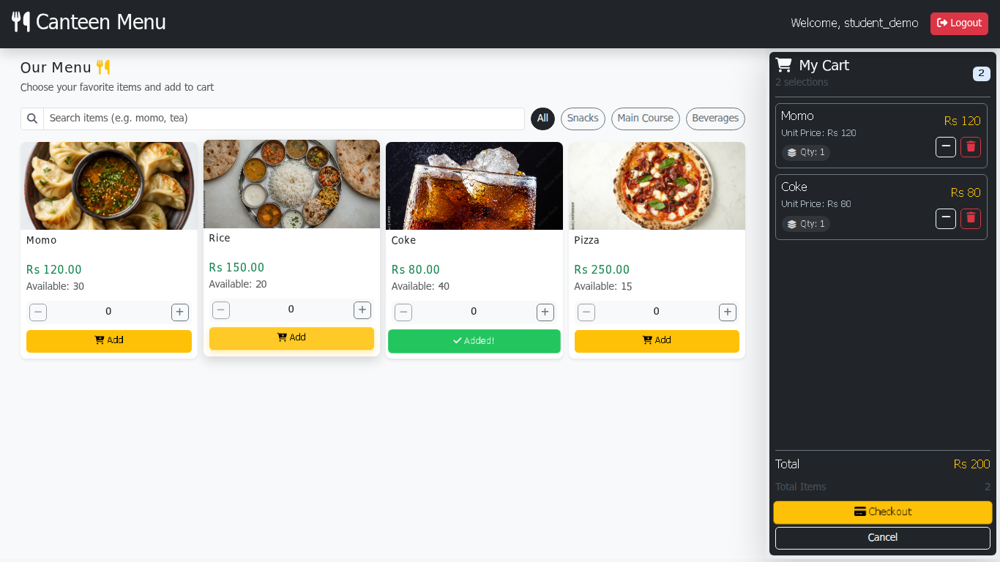

# Canteen Management System

A Django app for campus canteen ordering. Students and teachers browse the menu and place orders; canteen staff manage stock, review orders, and track sales.



*Customer menu with sample items.*

## Features

- Student, teacher, and admin accounts with unique five-digit user codes.
- Menu search, category filters, and a shopping cart.
- Checkout that checks available stock and updates quantities when an order is placed.
- Cash payment records and printable receipts.
- Staff tools for menu items, prices, images, and availability, plus order history and sales analytics.

The app uses Django 5.2.11 and vanilla JavaScript. Local development uses SQLite; deployment settings support PostgreSQL. Checkout records cash payments and does not connect to an online payment gateway.

## Run locally

Install Python 3.12, then run:

```sh
git clone https://github.com/SuhanVerse/CMS.git
cd CMS
python3.12 -m venv .venv
source .venv/bin/activate
python -m pip install -r requirements.txt
test -e .env || cp .env.example .env
python manage.py migrate
python manage.py createsuperuser
python manage.py runserver
```

When creating the admin account, enter a unique five-digit `user_code`, such as `10001`.

Open [http://127.0.0.1:8000/login/](http://127.0.0.1:8000/login/) and sign in with that account. The [staff dashboard](http://127.0.0.1:8000/admin_page/) lets you add menu items and set prices and stock. Students and teachers can create accounts at `/register/`, then sign in to browse `/menu/` and place an order.

To start a fresh local database with four sample menu items, run this after migrations and before starting the server:

```sh
python manage.py loaddata sample_menu
```

The sample contains menu items only. Create accounts yourself and add item images through the staff dashboard.

Local settings are used by default. Leave `DATABASE_URL` unset to use SQLite, and keep your local `.env` out of Git. See the [deployment guide](docs/deployment.md) for PostgreSQL, environment variables, static files, and media storage.

## Checks

```sh
python manage.py check
python manage.py makemigrations --check --dry-run
python manage.py test
```

## Documentation

- [Documentation index](docs/README.md)
- [Database schema and relationships](docs/database/README.md)
- [Project guide](docs/reference/project-guide.md)
- [DBMS study notes](docs/study/dbms-viva.md)

## Attribution

This repository is a fork of [SubhamParajuli/CMS](https://github.com/SubhamParajuli/CMS). The Git history records upstream work and changes in this fork.
