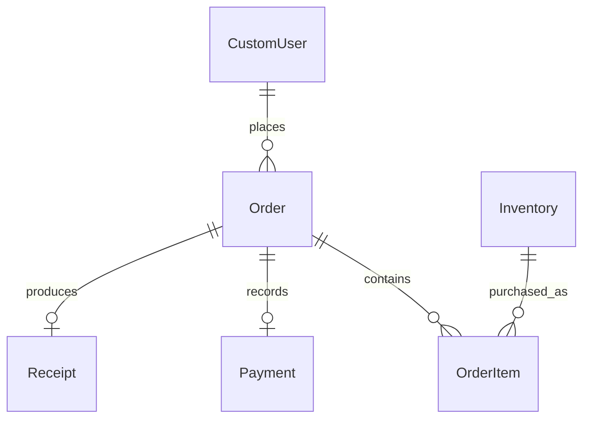

# Database reference

Django models and migrations define the application database. Use `python manage.py migrate` to create or update it; do not run the reference SQL files against an application database.

## Relationships

An order can have many line items. Each line refers to one inventory item and keeps the price at purchase. Payment and receipt links are unique, so an order can have at most one of each. The checkout transaction creates both for a paid order.

## Files

- [schema.dbml](schema.dbml): business tables and their relationships, for diagram tools.
- [schema.sql](schema.sql): annotated PostgreSQL schema with illustrative business checks.
- [relational-schema.sql](relational-schema.sql): an earlier, shorter PostgreSQL reference.
- [schema.pdf](schema.pdf): an earlier two-page export with duplicated schema content. It still labels inventory quantity as `BIGINT` and is not current migration output; the editable sources above use `INTEGER`.

These files omit Django's session, migration, permission, group, and admin-log tables. They are documentation rather than exact migration output. SQL defaults, extra `CHECK` rules, constraint names, and `ON DELETE CASCADE` clauses can differ from the schema Django creates. Django applies the model's cascade behavior through its deletion collector.

`Inventory.quantity` and `OrderItem.quantity` are `PositiveIntegerField` values, represented by PostgreSQL `INTEGER` with a nonnegative check. IDs use `BigAutoField`, represented by `BIGINT` identity columns. For backend-specific DDL, inspect the migrations with `python manage.py sqlmigrate <app> <migration>` against that backend.

## Where rules are enforced

| Rule | Implementation |
| --- | --- |
| Unique username and user code | Database unique constraints |
| Valid user role | Database check and model validation |
| Exactly five digits in `user_code` | Model and registration validation |
| Nonnegative stock and line quantities | `PositiveIntegerField` database checks |
| Quantity of at least one at checkout | Checkout validation |
| Positive whole-rupee menu price | Staff form validation |
| Valid menu category | Model choices and staff form validation |
| At most one payment and receipt per order | Database unique foreign keys |
| Matching payment total and paid-order records | Checkout transaction; `payment_consistency` audits existing rows |

Decimal money fields do not by themselves prevent negative values. Direct SQL or bulk ORM updates can bypass form and model validation, so the stricter checks in the reference SQL must not be assumed to exist in the application database.

## Sample data

[The sample menu](../../inventory/fixtures/sample_menu.json) contains four synthetic inventory rows and no accounts, sessions, orders, or payments. Load it with `python manage.py loaddata sample_menu` only on a fresh local demo database after migrations. Its fixed primary keys can replace existing inventory rows.
